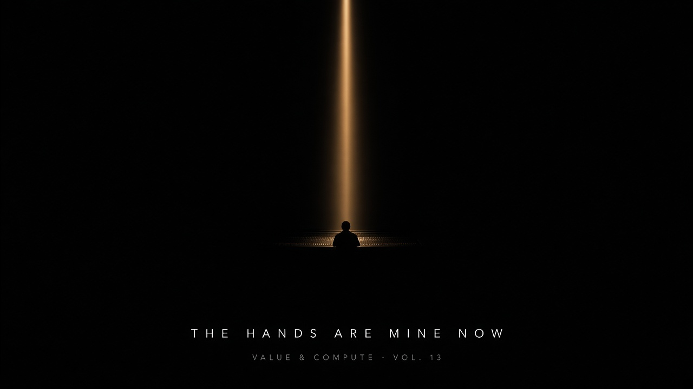

  

# Digital Currensy Inc.

Los Angeles. Software for music, sports, entertainment, electric vehicles, and lunar sites.

[digitalcurrensy.com](https://www.digitalcurrensy.com) · [Label IQ](https://app.labeliq.ai) · [Adrian Swish](https://adrianswish.xyz)

VALUE & COMPUTE · VOL. 13

  

  <a href="https://www.adrianswish.xyz/newsletter/vol-13">Read</a> · <a href="https://valuecompute.substack.com/p/value-and-compute-the-hands-are-mine">Substack</a> · <a href="https://medium.com/@labeliqai/value-compute-the-hands-are-mine-now-7ac21dbca218">Medium</a>

## Public work

| | |
| --- | --- |
| [module-kinetic-ltd](https://github.com/DigitalCurrensy/module-kinetic-ltd) | A broken charger is signed off, or it is refused. |
| [desks](https://github.com/DigitalCurrensy/desks) | One trend test, and eight gates for a lunar site. |
| [compton-one](https://github.com/DigitalCurrensy/compton-one) | A civic navigator for Compton. |
| [open-hood](https://github.com/DigitalCurrensy/open-hood) | The owner's car book. |
| [first-bucket-studios](https://github.com/DigitalCurrensy/first-bucket-studios) | A basketball pack, ripped in the browser. |
| [healthie](https://github.com/DigitalCurrensy/healthie) | A score for a food pack. Not the Healthie product. |

## Contact

[info@digitalcurrensy.com](mailto:info@digitalcurrensy.com) · [X](https://x.com/digitalcurrensy) · [Instagram](https://instagram.com/digitalcurrensy) · [YouTube](https://www.youtube.com/@DigitalCurrensy)

© 2026 Digital Currensy Inc.
